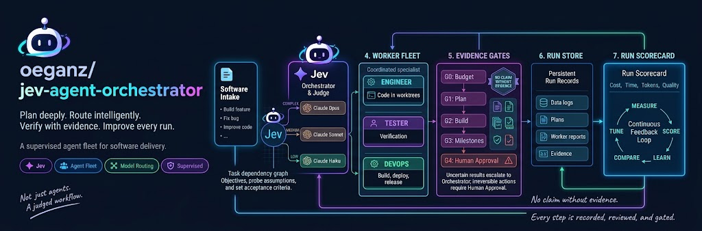
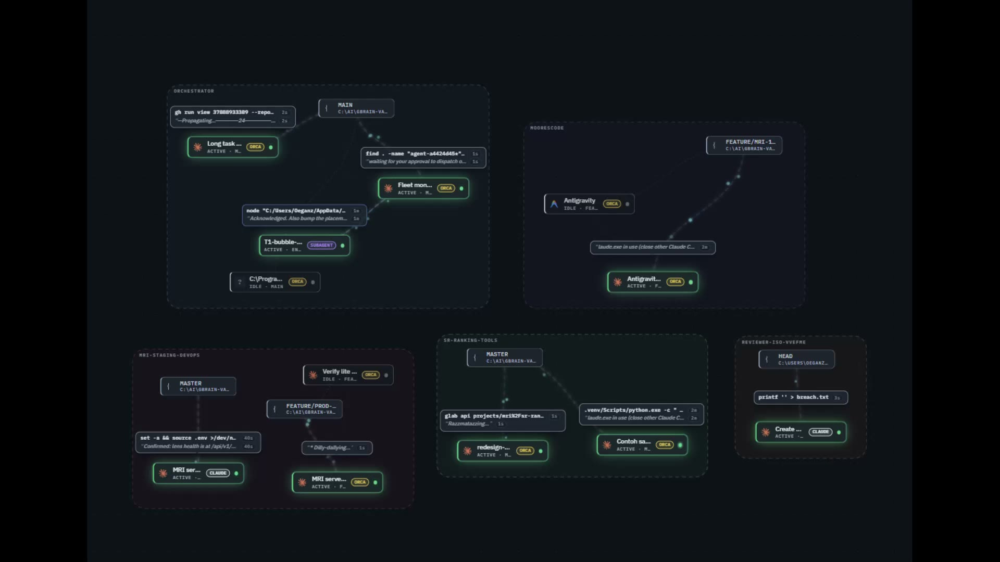
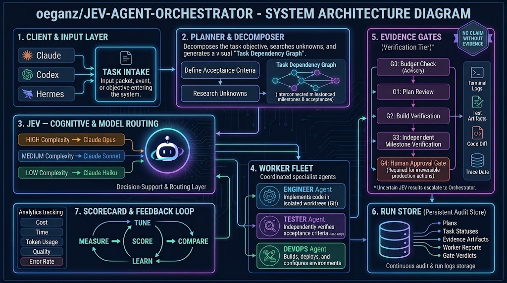

<p align="center">
  
</p>

# JEV Agent Orchestrator

A skill suite plus CLI harness that runs on Claude Code — not a plugin and not a
single skill. An agent-fleet orchestrator: a harness that takes a software task, decomposes it
into milestones and tasks, and runs it through supervised worker agents — a
planner, engineers, a tester and a devops worker — with a recorded, reviewed gate
at every step. The orchestrator is itself an agent session; workers are
dispatched as subagents, each in its own agent and its own git worktree where
isolation matters. No worker's claim is accepted as prose. Every gate verdict is
backed by a command the orchestrator re-runs itself and pastes raw into the run
store.

[](https://opensource.org/licenses/Apache-2.0)

[](https://github.com/oeganz/jev-agent-orchestrator/actions/workflows/ci.yml)


Live activity bubbles - each card shows the worker's current action and its
last words as they happen:

[](docs/assets/monitor-live-activity.mp4)

Canvas pan and drag - the whole board moves with the pointer while status
badges keep updating:

[](docs/assets/monitor-canvas-pan.mp4)

## Why this exists

Most multi-agent coding harnesses fail in one specific way: the author of a
change is also the person who reports that it works. A model asked to build
something will hand back a green test suite, a confident summary, and a change
that violates the requirement — and the suite stays green because the model also
wrote the test. The failure is not a crashed run. It is a run that looks
finished.

This project was built against the clock, not intuition. Over a development
sample of 14 runs, engineers were 63% of wall clock, 20% of tasks came back as
reworks, and the tasks that ran over an hour ate most of the clock. That figure
is a development measurement, not something this repository ships a report for —
it is quoted, with the 14-run sample stated, in
`.claude/skills/fleet-orchestrator/SKILL.md` and
`.claude/skills/fleet-planner/SKILL.md`. The rule it demanded — size every task
small, and dispatch one tester per milestone instead of one per task — is
carried in those same skills. The only run-level evidence that actually ships
here is the three example runs under `fleet/runs/`, and it is three runs, not
fourteen; read their numbers as a direction, never as a constant.

Two design choices follow directly:

- **The author of a change is the wrong person to verify it.** A separate agent
  verifies, and the orchestrator reproduces the evidence itself. "Tests pass" is
  a claim; the raw output is the evidence.
- **Everything is recorded.** The run store is the audit trail. Where the
  orchestrator and its decision service disagreed is the most valuable row in
  it, because it is how the thresholds get tuned.

The fleet is young. It is honest about what it has proven and what it has not —
see `QUICKSTART.md`, and the design document under `docs/superpowers/specs/`.

## Capabilities

| capability | what it does |
|---|---|
| **Task decomposition** | turns a one-sentence objective into milestones and tasks, each with an ownership boundary and a reproducible "Done when" command. |
| **Supervised worker dispatch** | runs a planner, engineers, a tester and a devops worker; workers run in their own git worktree when isolation matters. |
| **Gate model (G0–G4)** | every step passes a gate; G0 advisory budget, G1 plan, G2 per-task build, G3 per-milestone verify, G4 human-only for irreversible actions. |
| **Run store as audit trail** | every run writes `run.json`, `tasks.jsonl`, `gates.jsonl`, `reports/` and an optional `summary.md` to `fleet/runs/<run-id>/`; the dashboard reads the store, it does not keep a copy. |
| **Agent monitor dashboard** | a force-directed graph of every AI agent on the machine, polled live; ships with a built React UI under `monitor/dist/`. |
| **Export tooling** | a public-tree exporter (`fleet/bin/export-public.mjs`) produces a privacy-redacted subset of the repo with an allowlist and a redactions table. |
| **Doc drift + citation check** | `doc-check` validates the project-doc HTML against its evidence pointers; `doc-drift` catches citations that have moved or gone since a given base SHA. |
| **Decision-service failover** | JEV (TypeSafe System One) is the first-pass verifier; if it is uncertain, abstains, or is unreachable, the gate escalates to a full orchestrator review. JEV uncertainty never auto-passes. |

## Requirements

The runtime is plain Node ES modules; there are zero npm dependencies in
`fleet/bin/`. The harness runs anywhere Node does.

| tool | role | required? |
|---|---|---|
| **Claude Code** | the agent runtime — the orchestrator and workers are Claude Code sessions; the six skills are auto-discovered from `.claude/skills/` | yes |
| **Node >= 18** | runs `fleet/bin/` (developed on 24; CI runs Node 24) | yes |
| **git** | workers operate on a git checkout; the run store keys every gate to a commit SHA | yes |
| **Orca** | isolation-grade worker dispatch and terminals; without it the default subagent dispatcher still works | optional |
| **JEV** | external decision service, first-pass gate verifier; without it every gate falls back to a full orchestrator review | optional |

A git repository to run in is also required — the fleet operates on the repo it
is invoked from; clone, then run from inside it.

## Compatibility

- **Developed and primarily tested on** Windows 11 with Node 24. The README
  references one Windows caveat in passing (paths with `<` or `>` are invalid
  on Windows; test fixtures use placeholders).
- **Linux / macOS** — `fleet/bin/` is plain Node ESM and uses no platform-only
  APIs. CI runs on `ubuntu-latest` and is green.
- **What CI proves.** CI runs the install check plus 553 tests across 15
  fleet-suite files (excluding the live reviewer-isolation control) and the 2
  monitor server-side suites. The reviewer-isolation control is skipped in CI
  because it requires an interactive agent runtime on `PATH`; it runs locally
  when one is present.

## How to install

1. **Clone** the repository:

   ```bash
   git clone https://github.com/<owner>/jev-agent-orchestrator.git fleet
   cd fleet
   ```

2. **Check the Node version.** Anything `>= 18` works; 24 is what CI uses.

   ```bash
   node --version    # expect v18.x or newer
   ```

3. **Run the install check.** This probes the install and confirms the routed
   model can actually call tools — a model that emits tool calls as text makes
   a worker fail while looking like it is working.

   ```bash
   node fleet/bin/fleet.mjs doctor
   ```

   `doctor` exits non-zero on any failure. `node fleet/bin/fleet.mjs doctor
   --fast` skips the model probe when you only want to check the install.

4. **(Optional) Set up JEV.** JEV is optional. To enable it as a first-pass
   verifier, set `JEV_API_KEY` and point `fleet/config.json` `jev.base_url` at
   your endpoint (default placeholder `https://<your-jev-endpoint>/v1/systemone`).
   `JEV_BASE_URL` overrides the primary provider's endpoint when set — env
   wins over config, so a deploy can re-point JEV without editing files:

   ```bash
   echo 'export JEV_API_KEY=<redacted>' >> ~/.zshrc   # or your shell's rc
   ```

   The key is read in this order: the `env` block of `~/.claude/settings.json`,
   a `.env` at the repo root, then the real environment. A real `export`
   always wins.

5. **(Optional) Install the `orca` CLI.** Only needed for the isolation-grade
   dispatcher. Without it, the default subagent dispatcher works.

### Or: paste this into your agent

A visitor with Claude Code open can install and activate the fleet by
pasting one prompt block into a fresh session. The raw file lives at
[`docs/install-prompt.md`](docs/install-prompt.md).

<!-- SYNC: keep this block byte-identical with the block in
docs/install-prompt.md. Edit both together. -->
```
Install and activate the JEV Agent Orchestrator (https://github.com/oeganz/jev-agent-orchestrator).

Verify prerequisites first, and report each result:
- Node >= 18: run `node --version` and confirm the major version is 18 or higher.
- git: run `git --version` and confirm it is present.
- Host: Claude Code is the agent runtime this fleet runs on, and you are running
  in Claude Code right now, so this prerequisite is satisfied by construction.
  Do not try to detect it; just note it as satisfied.

If this repository is not already cloned on this machine, clone it:
- Repository: https://github.com/oeganz/jev-agent-orchestrator.git
- Ask me where to put the clone, propose a sensible default under my projects
  directory, and wait for my confirmation. Do not pick a location silently.

Then, from inside the checkout root (the directory containing fleet/):
1. Run the install check and read its full output:
     node fleet/bin/fleet.mjs doctor
2. Expect these to pass (lines starting "ok"): config.json, run store, the six
   skills (fleet-orchestrator, fleet-planner, fleet-engineer, fleet-tester,
   fleet-devops, jev-scoring), reviewer-settings.json, and the milestone store.
   Expect these as "note" lines, which are ADVISORY and correct on a clean
   machine, not errors: the global orchestration skill, CLAUDE.md (absent by
   design in this repo; the fleet-orchestrator skill is the real activation
   path), the orca CLI, orca reachability, and the JEV key. doctor exits 0 when
   all mandatory checks pass.

Activate:
- Tell me to open future Claude Code sessions in the checkout root. The six
  skills under .claude/skills/ are auto-discovered by Claude Code there.
  .claude/skills/fleet-orchestrator/SKILL.md is the orchestrator's operating
  manual; a session asked to "act as the fleet orchestrator" reads and follows
  it. Note this repository has no CLAUDE.md; activation is the skill, not a
  project file.

Optional extras, skip both and the fleet still works:
- JEV (decision service, first-pass gate verifier): set JEV_BASE_URL in your
  environment or point the providers' base_url entries in fleet/config.json at
  your JEV endpoint, and set JEV_API_KEY for it. Without a key, every gate
  falls back to a full orchestrator review - correct, just slower.
- Orca (isolation-grade dispatcher): install the orca CLI. Without it, worker
  dispatch uses Claude Code subagents.

Finish by reporting honestly:
- What you verified: paste doctor's summary line verbatim (the line starting
  "all checks pass" or a failure equivalent) and list any "note" lines.
- What you did not verify: say plainly whatever you skipped, and stop.
```
`QUICKSTART.md` is the operator's guide and is the right next read.

## Commands

`node fleet/bin/fleet.mjs <command>` is the full CLI. Run `node fleet/bin/fleet.mjs help` for the live list; this table is the same output.

| command | what it does |
|---|---|
| `status` | orca + fleet state (flags reclaimable terminals). |
| `status --json` | same data as one JSON object to stdout. |
| `settle` | release every reclaimable worker (hard rule 2). |
| `runs` | list runs. |
| `report <run-id>` | gate verdicts + summary for a run. |
| `timing [run-id]` | where the time went (worker vs orchestrator). |
| `score <run-id>` | five-axis scorecard (cost, time, price, quality, error rate); `--json` for machine output. |
| `cost` | today's spend vs the daily cap. |
| `estimate <path..>` | pre-flight cost RANGE for a set of paths. |
| `route "<task>"` | JEV skill-routing decision (one JSON line; exit 2 only if degraded). |
| `resume <run-id>` | take the lease and reconcile state. |
| `doctor` | check the install. |
| `doc-check <html> [--root <dir>]` | validate a project-doc HTML and its evidence pointers. |
| `doc-gap <html> <review.json>` | human-vs-AI gap report (markdown). |
| `doc-drift <doc.html> <base-sha> [--json] [--fix]` | drift between a doc's citations and `<base-sha>` (exit 1 on moved/gone). |

## Architecture: how a run works

A run moves through six stages. Each is either the orchestrator's own work or a
worker dispatch, and each leaves a row behind.

<p align="center">
  
</p>

Gates G1–G3 run JEV as a first-pass verifier; the orchestrator is the decider of
record. A budget gate G0 runs before the first dispatch and is advisory (see
below). Any irreversible action stops the run for a human decision (G4).

Rendered diagrams ship in the tree: `docs/diagrams/index.html` (open it in a
browser) and the wider project document at `docs/project-doc.html`.

## The agent monitor

The monitor is a live, force-directed graph of every AI agent session on the
machine. Cards are grouped by project, statuses update as workers run and
finish, speech bubbles show what an agent is doing in real time, and the whole
canvas can be dragged and panned. The two recordings at the top of this README
show it live - the first is activity bubbles, the second canvas pan and drag.

Two short screen recordings also ship in the repo if the embeds do not load:
[`docs/assets/monitor-live-activity.mp4`](docs/assets/monitor-live-activity.mp4)
and [`docs/assets/monitor-canvas-pan.mp4`](docs/assets/monitor-canvas-pan.mp4).

The monitor also serves a dashboard over the run store:
```bash
node fleet/bin/lib/dashboard-server.mjs
# fleet dashboard on http://localhost:8788  (PORT=... to override)
```

The monitor itself lives under `monitor/` (built React UI in `monitor/dist/`). Run it with:

```bash
MONITOR_PORT=8790 node monitor/server.mjs     # -> http://localhost:8790
```

## Quickstart: the smallest real run

`QUICKSTART.md` in this tree is the full operator's guide — read it next. The
short version:

1. Open an agent session in the repo root and load the `fleet-orchestrator`
   skill — the six skills under `.claude/skills/` ship with this repository,
   and loading that one turns the session into the orchestrator. A
   `CLAUDE.md` at the repo root, if your checkout has one, is a convenience
   pointer the Claude Code session will auto-load; it is **advisory** in this
   tree (deliberately not part of the exported public-tree copy), and the
   real activation path is the skill. Describe the task in plain language:

   > load the fleet-orchestrator skill, then: add a `--verbose` flag to the
   > deploy script, with tests

   In a Claude Code session the skills are already on disk, so `/fleet-orchestrator`
   loads it by name; if your harness has no slash-command surface, tell the
   session in plain words to read and follow
   `.claude/skills/fleet-orchestrator/SKILL.md`. The other five skills
   (`fleet-planner`, `fleet-engineer`, `fleet-tester`, `fleet-devops`,
   `jev-scoring`) are a tab completion away for the orchestrator once it is
   running.

2. Run `node fleet/bin/fleet.mjs doctor` before your first real task.
3. The orchestrator loads its skill, plans, dispatches workers, reviews gates
   against evidence it reproduces, and reports back. You are the only one who
   talks to it.

Inspect what happened with the CLI:

```bash
node fleet/bin/fleet.mjs runs                 # every run, status, gate/task counts
node fleet/bin/fleet.mjs report <run-id>      # gate verdicts + the summary
node fleet/bin/fleet.mjs timing [run-id]      # worker vs orchestrator time
node fleet/bin/fleet.mjs status               # dispatcher up? runs? reclaimable workers?
node fleet/bin/fleet.mjs settle               # release finished workers
```

## The gate model

Every step of a run passes a gate. Which are automatic and which need a human is
deliberate, and the names are exactly those in `fleet/config.json`:

| gate | what it checks | who decides |
|---|---|---|
| **G0** budget | today's spend against the daily cap, before the first dispatch | **advisory** while `budget.daily_cap` is `null` — it reports and never blocks |
| **G1** plan | the plan is sized, has no overlapping ownership, every task is observable, irreversible steps are flagged | **automatic** (JEV first-pass, then the orchestrator) |
| **G2** build | per task: diff scope matches the authorised file list, `git status` is clean outside it, the task's own `Done when:` command exits 0 | **automatic** and mechanical/cheap |
| **G3** verify | once per milestone: a fresh tester re-runs every acceptance criterion | **automatic** (JEV first-pass, then the orchestrator) |
| **G4** irreversible | deploy, push, force-push, delete-data, infra-change, spend-above-cap | **human only** — JEV never scores G4 |

Three rules make the gates mean something:

- **JEV is a first-pass filter, never the decision of record.** If any of its
  risk flags exceeds the threshold (0.55 in `fleet/config.json`), the change goes
  to rework. If JEV is uncertain, abstains, or is unavailable, the gate escalates
  to a full orchestrator review. JEV uncertainty never auto-passes.
- **Raw output, never a summary.** A gate state that summarises test output
  ("4 tests, 4 pass") reads as *no output shown* to the JEV tests-missing
  question and scores a false 0.68; the same task with the raw output pasted
  scores 0.03. This is a measured rule, not a preference.
- **Irreversible actions always come to the human.** No worker, no gate and no
  JEV verdict can approve a deploy or a push.

## The run store

Every run is a directory under `fleet/runs/<run-id>/`. The run store is the
source of truth — the dashboard reads it, it does not keep its own copy.

```
run.json         objective, status, base/final sha, dispatcher, gate list
plan.md          the planner's human-readable plan (when a planner ran)
milestones.json  milestones: id, title, tasks, acceptance, est_min
tasks.jsonl      one row per dispatch, each with the base_sha for its diff
gates.jsonl      one row per gate: verdict, why, the reproduced evidence
reports/         what each worker actually wrote — the raw evidence
summary.md       the consolidated report for the run
```

**Three real example runs ship in the tree.** Start with
`fleet/runs/20261003-2310-defect-hunt/`. Open it and read in this order:
`run.json` (the objective — a defect was *deliberately planted* to test whether a
green suite hides a bug), then `gates.jsonl` (one row shows JEV catching it at a
risk flag of 0.89 and an independent reviewer catching it too), then
`reports/eng-2.md` (the engineer's report) and `reports/g2-independent.md` (the
reviewer explaining *why* the suite missed it — the covering test wrote its file
in a subdirectory, so it never exercised the root).

The other two examples:
`fleet/runs/20261003-2245-hello-runcount/` is the smallest complete run, and
`fleet/runs/20261004-0200-rework-loop/` shows a gate returning rework, the fix
being dispatched citing the failing evidence, and re-verification.

Read any of them with the CLI rather than opening files by hand:

```bash
node fleet/bin/fleet.mjs report 20261003-2310-defect-hunt
node fleet/bin/fleet.mjs timing 20261004-0200-rework-loop
```

Note which files appear. `run.json`, `tasks.jsonl`, `gates.jsonl` and
`reports/` are always present. `summary.md`, `plan.md` and `milestones.json` are
written when the corresponding stage runs — a small inline run may have no
planner and no `plan.md`, and the three example runs above predate the milestone
store, so they carry no `milestones.json`. `node fleet/bin/fleet.mjs doctor`
reports how many runs have a milestone file and flags the rest as legacy
(advisory, not a failure).

## Archiving session transcripts (optional)

The fleet can archive an operator's own agent transcripts into the run store's
sibling directory, scrubbed of credentials and machine paths, so a project keeps
a record of how its work was actually done:

```bash
node fleet/bin/import-sessions.mjs --source <dir-of-raw-transcripts>
```

Transcripts are **not shipped with this repository** — they describe one
operator's machine and their own sessions, and a reader does not need them to
run anything. The importer is included so any operator can build their own
archive.

## The worker roles

Six skills under `.claude/skills/` define the roles. Each is a prose instruction
set, not code.

| skill | the role it plays |
|---|---|
| `fleet-orchestrator` | the boss: intake, decompose, dispatch, review each gate, settle the run. Does not implement. |
| `fleet-planner` | turns an objective into a plan and a task DAG, with milestones, ownership boundaries and acceptance per task. |
| `fleet-engineer` | the only role that writes code: implements exactly one task spec, test-first, and reports raw evidence. |
| `fleet-tester` | a fresh agent that verifies a completed task independently — re-runs the criteria, changes nothing, and states what it did not verify. |
| `fleet-devops` | build, release, deploy, rollback and infrastructure work against a spec. |
| `jev-scoring` | how to score any artifact with JEV: build the questions, choose thresholds, call the endpoint. |

## Status: what is proven, what is not

This project states its own limits in the run store rather than in a changelog.

**Proven in the shipped evidence.** The loop runs end to end across real runs. A
deliberately planted defect that a green test suite did not catch was caught by
both the independent reviewer and the decision service (see
`fleet/runs/20261003-2310-defect-hunt/`). The rework branch closes: a gate
returns rework, a fix is dispatched citing the failing evidence, and it is
re-verified (`20261004-0200-rework-loop`). Reviewer isolation holds. The
decision-service failover works with a broken primary endpoint. Raw gate output
changed a score from a false 0.68 to a correct 0.03 — the raw-output rule.

**Not proven.** A cold session completing a whole loop fully unattended. The
runs above were driven by an already-informed session; a cold session reads its
instructions and holds its boundary, but that is not the same claim.

**Not built.** The daily budget cap (`budget.daily_cap` in `fleet/config.json`)
is `null`, because the real figure is uncalibrated and the proxy meter is not
readable programmatically. While it is null, G0 reports and never blocks.

**Honest about itself.** The orchestrator is its own largest error source, and
the design says so directly rather than in a changelog. It is a single long-lived
session that will hit context limits, get compacted, crash or be killed; its
context is only a cache, and the run store on disk is the truth — every fact
needed to resume lives in `run.json`, `tasks.jsonl`, `gates.jsonl` and
`reports/`, so a fresh session can reconstruct a run from disk. The claim, and
the defence, are in the shipped design document:
`docs/superpowers/specs/2026-10-03-agent-fleet-orchestrator-design.md`
(section 16.2, "The orchestrator is a single point of failure — and that is by
design"). The same document is blunt where this repository is thin: the cost
estimator's dominant term is turns times context size, and its own code calls
that term coarse (`fleet/bin/lib/estimate.mjs`). The sample sizes everywhere are
small — treat every rate here as a direction, not a constant.

## Contributing

See [`CONTRIBUTING.md`](CONTRIBUTING.md) for the contribution process: how to
run the install check, the test suite, and the project's own standard for a
ready change. A change that cannot be verified by a command someone else can
run is not ready to merge.

Changes to the fleet's own behaviour live in **skills**, and a skill change is
still a behaviour change — add or update a test under `fleet/bin/` alongside it.
The `*.test.mjs` files next to the code are the suite; run one with
`node --test fleet/bin/<name>.test.mjs`.

## License

Apache-2.0. The full text is in [`LICENSE`](LICENSE).