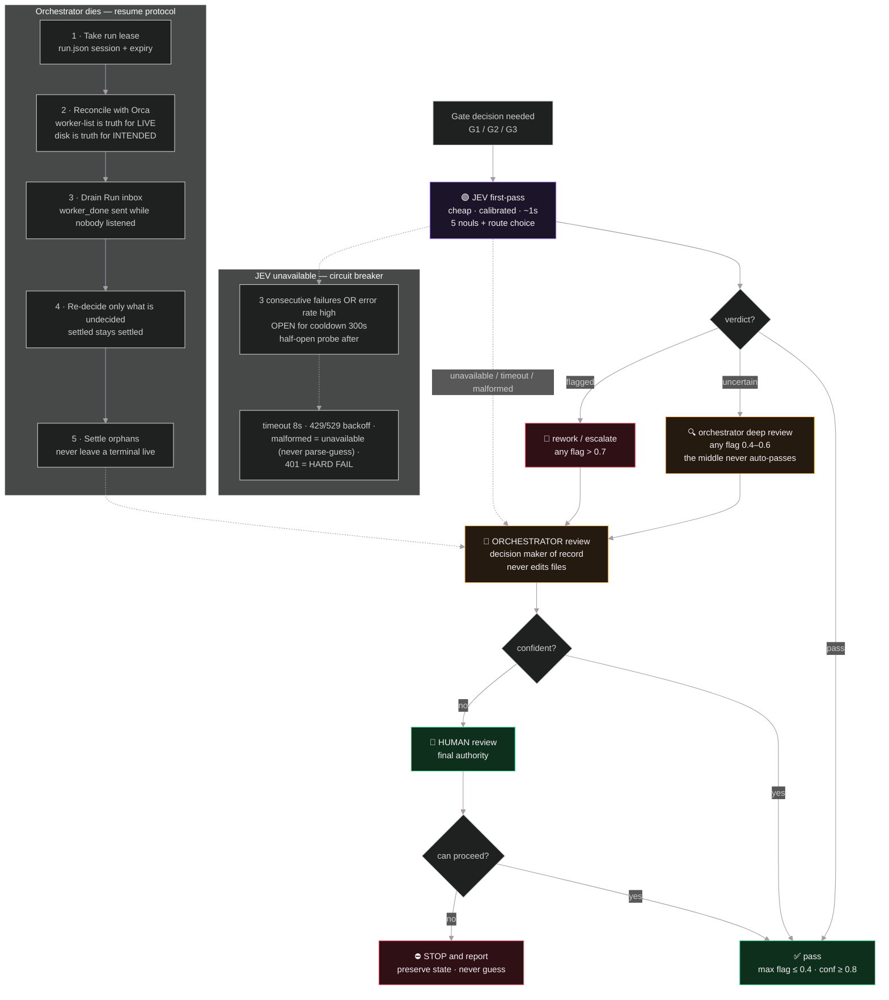
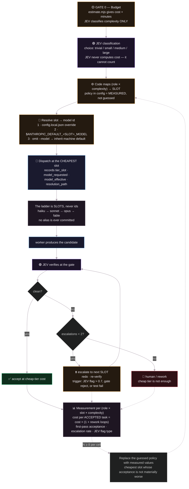

# Fleet Orchestrator Diagrams

Rendered below from the `.mmd` sources — Obsidian renders these natively, no JS required.

- **Browser version:** `index.html` (all five; loads mermaid from a CDN, so it needs a network connection)
- **Static lifecycle-only:** `fleet-flow.html`
- **Spec:** `../superpowers/specs/2026-10-03-agent-fleet-orchestrator-design.md`

## 1 · Run lifecycle

Full flow from your request to settled terminals, including the rework loop.

```mermaid
%%{init: {"theme": "dark", "themeVariables": {"primaryColor": "#1e1622", "primaryBorderColor": "#e551ba", "primaryTextColor": "#f2eef4", "lineColor": "#a89ba8", "fontSize": "14px"}}}%%
flowchart TD
    YOU["👤 You<br/>type request into orchestrator pane"]
    EST["📊 Static pre-scan + estimate<br/>estimate.mjs · free, no LLM<br/>files / bytes / lang-mix → tokens · minutes · confidence"]
    G0{"🟡 GATE 0 — Budget<br/>spend + estimate vs daily cap<br/>cheaper-path options"}
    RC["📁 run-create<br/>objective recorded · mode resolved<br/>runs/&lt;id&gt;/ created"]
    PF["🟣 Spec pre-flight (JEV)<br/>5 nouls: Target · Change · Constraints<br/>Ownership · Observable acceptance"]
    PLANNER["🔵 PLANNER<br/>plan + task DAG · never writes<br/>may fan out read-only scanners"]
    G1{"🟡 GATE 1 — Plan approved<br/>JEV first-pass + orchestrator"}
    WAVES["📋 Tasks in ready waves<br/>only real dependencies (--deps)<br/>independent tasks in parallel"]
    ENGINEER["🔵 ENGINEER<br/>TDD · may write own file set<br/>may fan out sub-implementers"]
    G2{"🟡 GATE 2 — Build accepted<br/>JEV: spec_violated · tests_missing · scope_creep<br/>evidence_gap · regression_risk"}
    TESTER["🔵 TESTER — FRESH terminal<br/>never engineer context · falsification stance<br/>states what it did NOT verify"]
    G3{"🟡 GATE 3 — Verified<br/>JEV first-pass"}
    G4{"🟢 GATE 4 — Irreversible<br/>HUMAN ALWAYS<br/>deploy · push · delete · infra · spend"}
    DEVOPS["🔵 DEVOPS<br/>only behind approved gate<br/>deploy result + rollback proven"]
    CONS["📄 Consolidate → summary.md<br/>per task: outcome · evidence · blockers"]
    SETTLE["✅ Settle every terminal<br/>reuse · retain · release"]

    YOU --> EST --> G0 --> RC --> PF --> PLANNER --> G1
    G1 -->|approved| WAVES --> ENGINEER --> G2
    G2 -->|accepted| TESTER --> G3
    G3 -->|verified| G4 -->|approved| DEVOPS
    G3 -->|no deploy needed| CONS
    G4 -->|rejected / rollback| CONS
    DEVOPS --> CONS --> SETTLE

    G2 -.->|"fail: new engineer task<br/>cites failing evidence"| ENGINEER
    G3 -.->|"fail: rework loop<br/>visible in tasks.jsonl"| ENGINEER

    style YOU fill:#0f2f1d,stroke:#3ddc97,color:#f2eef4
    style G0 fill:#241a10,stroke:#ffb454,color:#f2eef4
    style G1 fill:#241a10,stroke:#ffb454,color:#f2eef4
    style G2 fill:#241a10,stroke:#ffb454,color:#f2eef4
    style G3 fill:#241a10,stroke:#ffb454,color:#f2eef4
    style G4 fill:#0f2f1d,stroke:#3ddc97,color:#f2eef4
    style PF fill:#1c1428,stroke:#b48cff,color:#f2eef4
    style EST fill:#1c1428,stroke:#b48cff,color:#f2eef4
```

## 2 · Gate anatomy

Inside an auto-mode gate (G1–G3): JEV first-pass, policy in code, raw probabilities logged.

```mermaid
%%{init: {"theme": "dark", "themeVariables": {"primaryColor": "#1e1622", "primaryBorderColor": "#e551ba", "primaryTextColor": "#f2eef4", "lineColor": "#a89ba8", "fontSize": "14px"}}}%%
flowchart TD
    TRIG["Gate reached (G1/G2/G3)<br/>worker_done settled"]
    ASSEMBLE["📦 Assemble gate state<br/>spec + report + evidence excerpts<br/>test output tail · diff stat · under 12k chars<br/>NEVER whole transcripts"]
    REQ["🟣 ONE JEV request<br/>all questions in parallel + isolation"]

    subgraph BATTERY["Noul battery — one narrow question per claim"]
      N1["spec_violated<br/>violates explicit constraint?"]
      N2["tests_missing<br/>evidence omits required test output?"]
      N3["scope_creep<br/>changes beyond the spec?"]
      N4["evidence_gap<br/>report claims what evidence does not show?"]
      N5["regression_risk<br/>other functionality may break?"]
    end

    ROUTE["Route choice<br/>pass · rework · escalate_planner · ask_human"]

    POLICY{"⚙️ Policy in CODE<br/>never in the questions"}
    PASS["✅ pass<br/>max flag ≤ 0.4<br/>choice conf ≥ 0.8"]
    REVIEW["🔍 orchestrator deep review<br/>any flag in 0.4–0.6<br/>the middle never auto-passes"]
    REWORK["🔁 rework / escalate<br/>ANY flag > 0.7<br/>max-gate: one confident red flag is enough"]
    HUMAN["👤 ask_human<br/>choice top-prob < 0.6"]

    LOG["📝 gates.jsonl<br/>raw distributions · fingerprint · question_set_version<br/>model · policy_applied · human_override"]

    TRIG --> ASSEMBLE --> REQ --> BATTERY --> ROUTE --> POLICY
    POLICY --> PASS
    POLICY --> REVIEW
    POLICY --> REWORK
    POLICY --> HUMAN
    POLICY --> LOG

    style TRIG fill:#1e1622,stroke:#e551ba
    style ASSEMBLE fill:#1e1622,stroke:#6bb8ff
    style REQ fill:#1c1428,stroke:#b48cff
    style ROUTE fill:#1c1428,stroke:#b48cff
    style POLICY fill:#241a10,stroke:#ffb454
    style PASS fill:#0f2f1d,stroke:#3ddc97
    style REVIEW fill:#241a10,stroke:#ffb454
    style REWORK fill:#2f1015,stroke:#ff6b81
    style HUMAN fill:#0f2f1d,stroke:#3ddc97
    style LOG fill:#1e1622,stroke:#a89ba8
```

## 3 · Fallback ladder & failure paths (§16)

JEV → orchestrator → human → stop. An unavailable rung moves the decision DOWN, never up. Includes the JEV circuit breaker and the orchestrator resume protocol.

## 4 · Model decision & escalation cascade (§15)

JEV classifies, code maps to a SLOT (never a hardcoded model id), escalation only on evidence; cost per ACCEPTED task is the metric that decides.

## 5 · Fan-out and depth cap (§6)

Planner scan example; depth 2 is the hard cap.

```mermaid
%%{init: {"theme": "dark", "themeVariables": {"primaryColor": "#1e1622", "primaryBorderColor": "#e551ba", "primaryTextColor": "#f2eef4", "lineColor": "#a89ba8", "fontSize": "14px"}}}%%
flowchart TD
    ORCH["Depth 0 — ORCHESTRATOR<br/>owns the Run · dispatches specialists"]

    subgraph D1["Depth 1 — specialists (own Orca terminals, fresh context)"]
      PLANNER["🔵 PLANNER<br/>may fan out read-only scanners"]
      ENGINEER["🔵 ENGINEER<br/>may fan out sub-implementers on disjoint files"]
      TESTER["🔵 TESTER<br/>may fan out sub-testers on disjoint suites"]
    end

    subgraph D2["Depth 2 — HARD CAP<br/>scanners · sub-implementers · sub-testers<br/>NO further fan-out"]
      S1["scan Company/"]
      S2["scan Projects/"]
      S3["scan Personal Branding/"]
      S4["scan VPS/"]
    end

    SCHEMA["Same return schema each:<br/>dir · files · purpose · key_entities · risks · open_questions<br/>scanners report — they never conclude"]
    REGROUP["🔵 PLANNER regroups<br/>dedupe · resolve conflicts · flag gaps → one plan"]
    UTIL["utilization = Σ(task durations) ÷ wall-clock<br/>near 1.0 = fan-out paid off · near 0.25 = paid the toll for nothing"]

    ORCH --> PLANNER & ENGINEER & TESTER
    PLANNER --> S1 & S2 & S3 & S4
    S1 & S2 & S3 & S4 --> SCHEMA --> REGROUP
    REGROUP -.-> UTIL

    style ORCH fill:#241a10,stroke:#ffb454
    style PLANNER fill:#1a1a2e,stroke:#6bb8ff
    style ENGINEER fill:#1a1a2e,stroke:#6bb8ff
    style TESTER fill:#1a1a2e,stroke:#6bb8ff
    style SCHEMA fill:#1c1428,stroke:#b48cff
    style REGROUP fill:#1a1a2e,stroke:#6bb8ff
    style UTIL fill:#1e1622,stroke:#a89ba8
```

